# Modelos 3D

## suporte-motor-drone

### Suporte onde o Motor DC 555-2990 vai ser encaixado.

O suporte foi projetado com uma abertura lateral e furos para os parafusos. Assim, o motor pode ser encaixado com facilidade, após apertar os parafusos, o suporte segura o motor.

Do outro lado, 5 furos foram posicionados para parafusar na peça encaixe-arm-motordrone. Os 5 parafusos em forma de cruz permitem que o suporte pode ser colocado tanto na vertical quanto na horizontal.

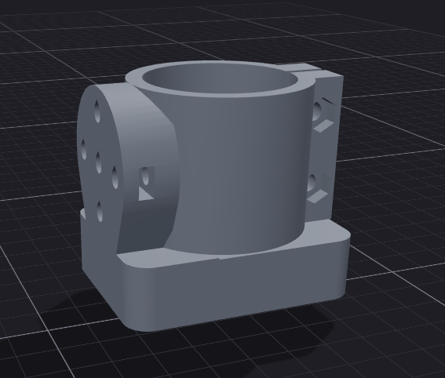

Em baixo do suporte, uma abertura foi feita para encaixar o encoder AS5047p.

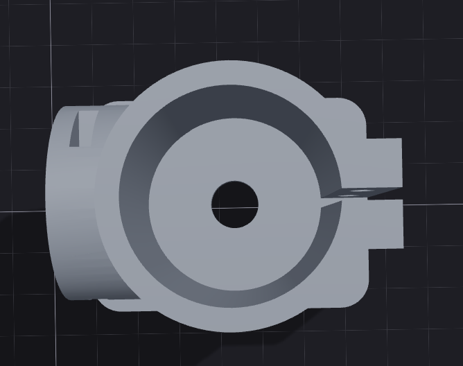

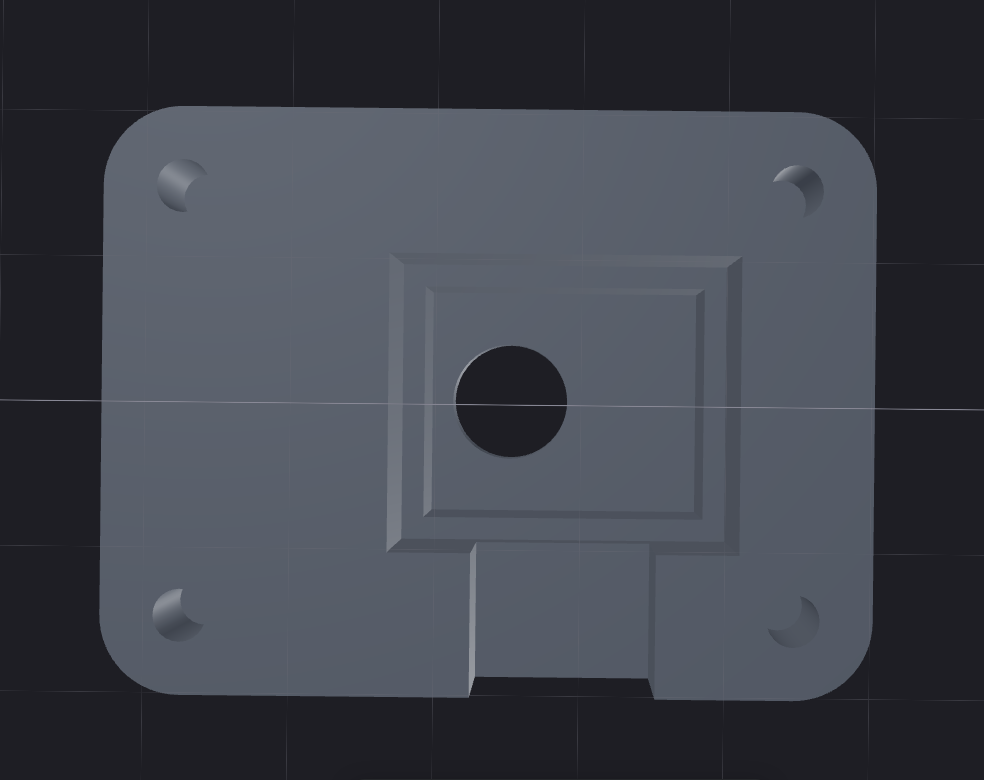

---

## tampa-motor-drone

### Tampa para fechar e fixar o encoder em baixo do suporte do motor.

Essa tampa foi projetada para levantar um pouco a altura do encoder, deixando um pequeno espaço para os fios passarem.

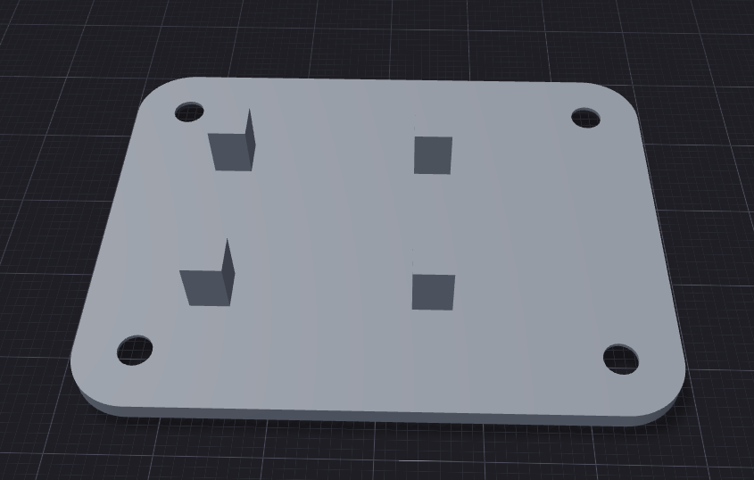

---

## encaixe-arm-motordrone

### Encaixe que fixa o suporte do motor ao braço

Esse encaixe possui 3 furos que serão utilizados para fixar as duas peças.

Na horizontal, os outros 2 furos são utilizados para fixar o encaixe à peça arm.

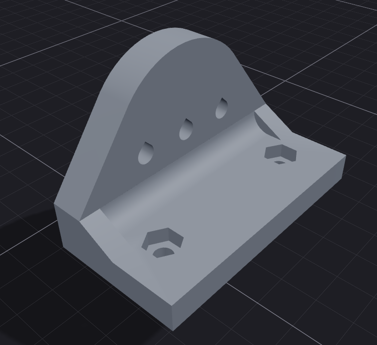

---

## arm

### Braço que fixa a junção do suporte que segura o motor ao hub central.

Esse braço possui duas extremidades. A primeira com 2 furos é utilizada para fixar a peça encaixe-arm-motordrone, enquanto a outra extremidade com 4 furos é utilizada para fixar o braço ao hub central.

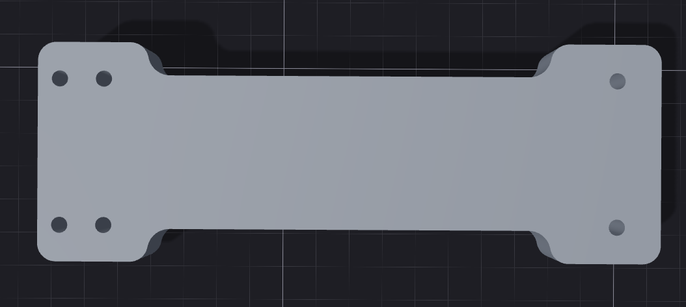

---

## central-hub

### Hub que fica no centro, tem espaço para o acelerômetro e segura os dois braços.

O furo no meio será utilizado para encaixar o eixo que será fixo e girará junto com os rolamentos. Enquanto isso, os 4 furos de cada lado são utilizados para fixar os braços

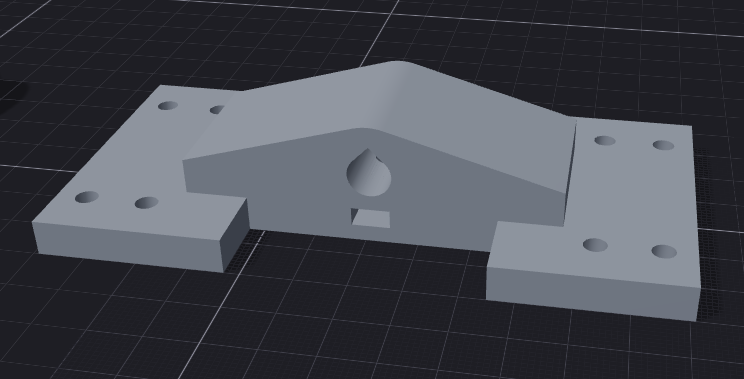

Em baixo, há um espaço para encaixar o acelerômetro. 

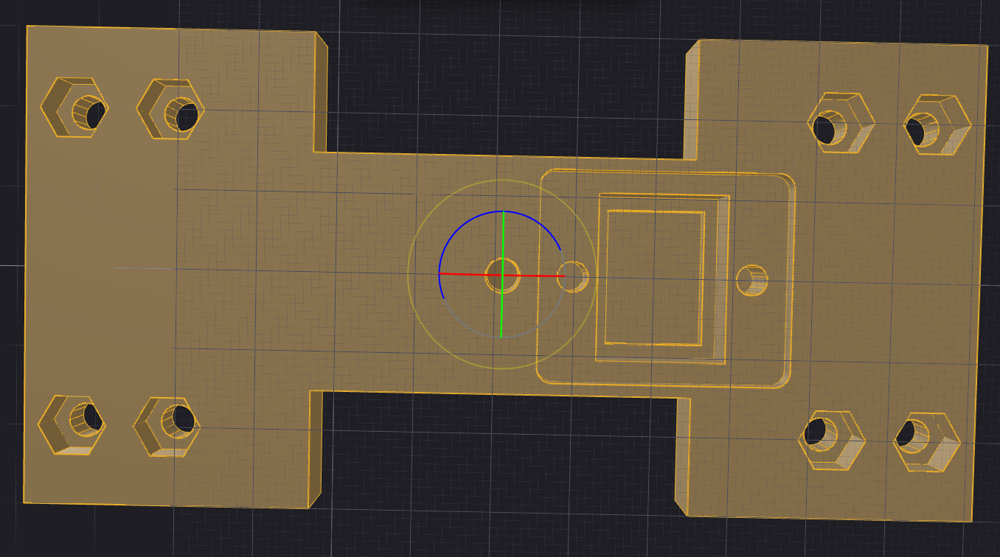

---

## tampaCentralHub

### Tampa que fixa o acelerômetro em baixo do hub central.

Um pequeno suporte eleva a altura do acelerômetro. Alguns furos foram feitos para a passagem da fiação.

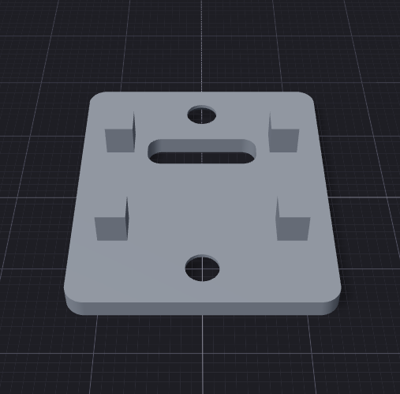

---

## Junção da primeira parte

### Formação da primeira parte, "gangorra".

Juntando as peças - suporte-motor-drone (2x), encaixe-arm-motordrone (2x), arm (2x) e central-hub - é possível visualizar a primeira parte da plataforma, que funciona como uma gangorra.

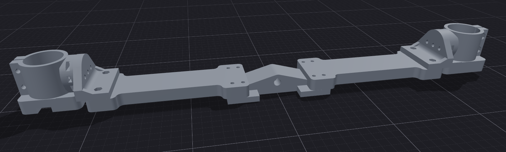

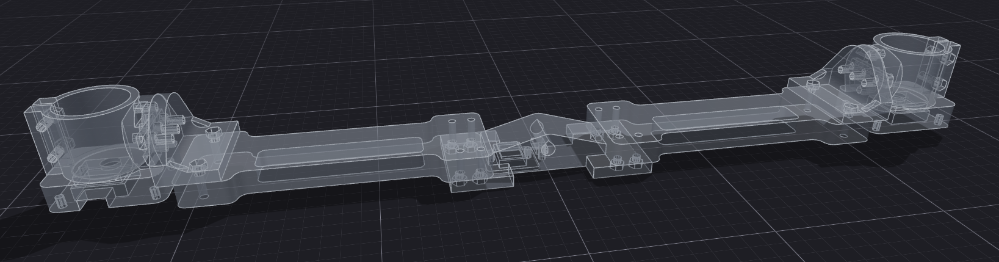

---

## novoTopo

### Topo do projeto, onde ficam os rolamentos e o eixo que segura o hub central.

De cada lado, um rolamento 608 será encaixado, enquanto um eixo irá atravessar eles e o hub central.

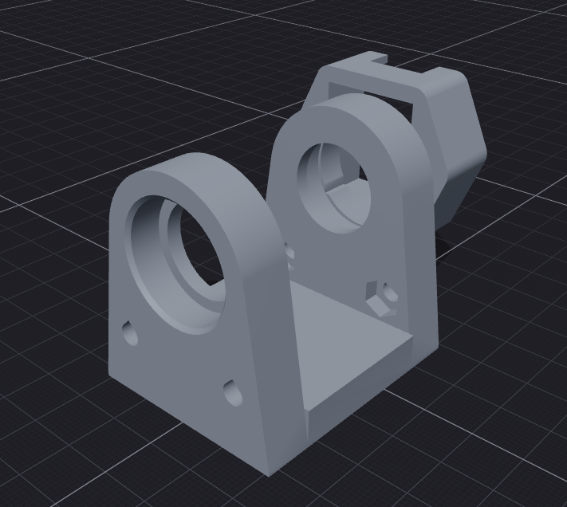

Em um dos lados, um encoder AS5047P será utilizado para medir a inclinação da "gangorra".

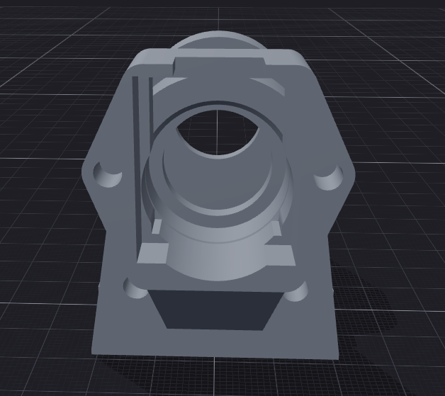

---

## tampaNovotopo

### Tampa que segura o encoder do novoTopo.

Uma tampa com pequenos suportes para deixar espaço para fiação irá prender o encoder AS5047p na lateral do novoTopo

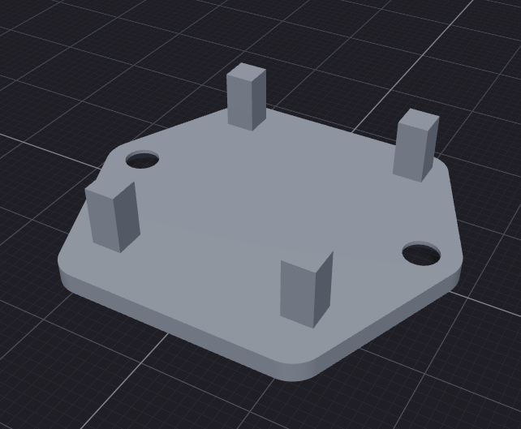

---

## eixoRolamentosEnconders

### Eixo que irá atravessar as peças.

Esse eixo girará junto com os rolamentos e será fixado no hub central. Em uma das extremidades, um imã será fixado para que o encoder possa medir a inclinação.

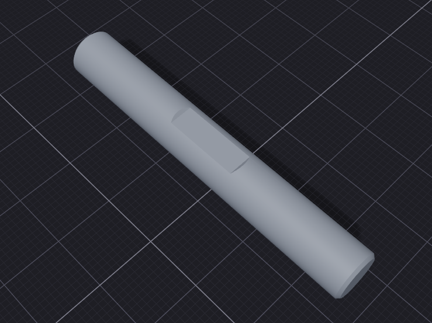

---

## Y1 e Y2

### Duas peças que formam uma estrutura em formato de "Y".

Essas peças foram modeladas para que possam ser encaixadas e parafusadas.

Ela foi separada em duas peças para que fosse possível passar a fiação enquanto mantem esse formato de "Y". 

No topo dela, o novoTopo será fixado com parafusos. Em baixo, uma pequena parede será utilizada para limitar a rotação no plano XY. Um pequeno furo no centro será utilizado para fixar essa estrutura no encoder yaw que fica dentro da caixa.

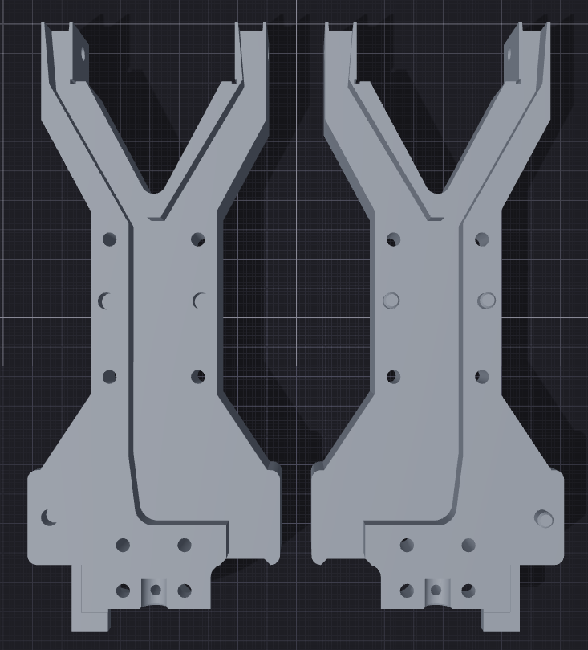

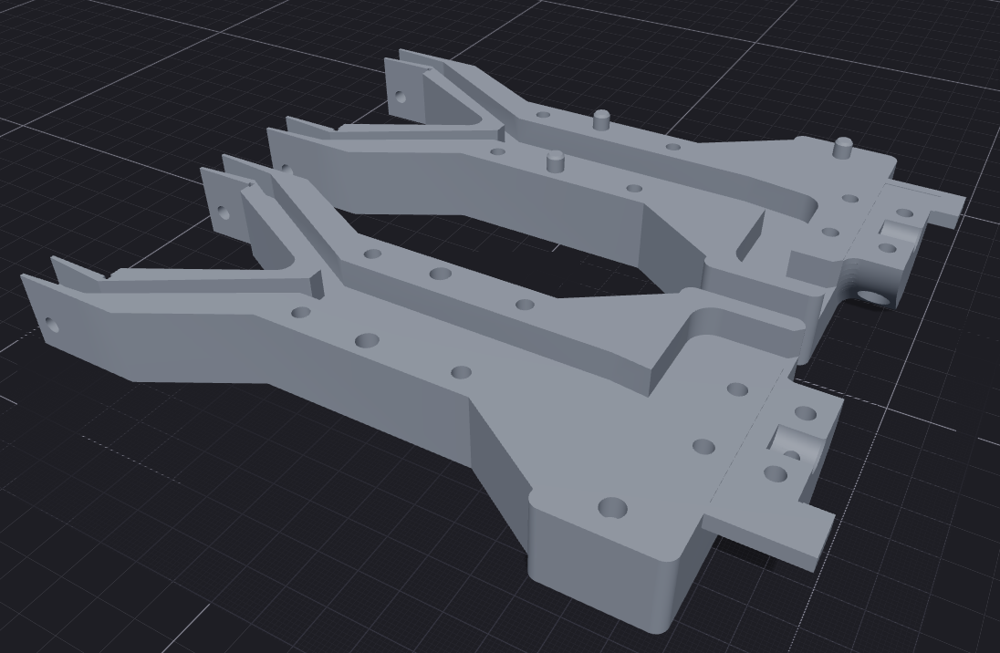

---

## Junção da segunda parte

### Formação da segunda parte em formato de "Y".

Juntando Y1, Y2, novoTopo e o eixoRolamentosEncoders, formamos a estrutura que sustentará a "gangorra", permitirá que ela possa se inclinar e poder girar 120° graus

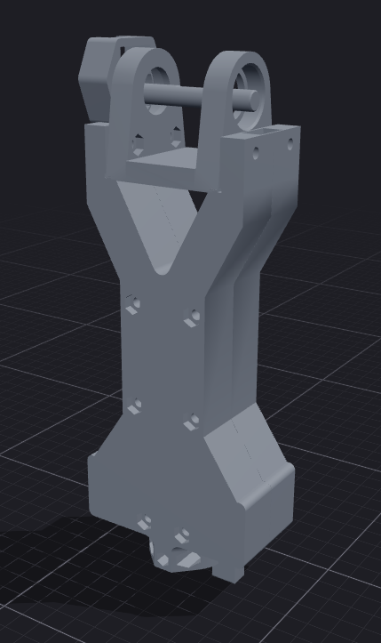

